# TV Screensaver Scenes

Silent, animated screensaver scenes for a TV launcher, drawn live in code: no images, video or sound. The scenes tagged `riso` look like risograph prints: halftone inks on paper. The scenes tagged `pixel` are pixel art: a small, hand-placed picture with a limited palette and dithered shading, scaled up crisply. A TV launcher fetches the list of scenes from this repo, the user picks the ones they like in settings, and the launcher downloads, verifies and plays them.

**Preview:** https://kjartan-jobloop.github.io/tv-screensaver-scenes/

| | Scene | Tags |
|---|---|---|
|  | Night sky | night, calm |
| 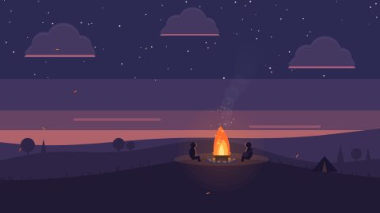 | Bonfire | night, nature, calm |
|  | Koi pond | water, calm, nature |
| 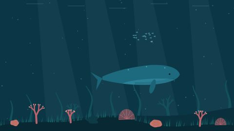 | Whale | water, calm |
|  | Lighthouse | night, water, calm |
| 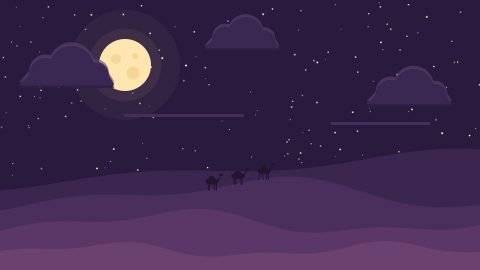 | Desert night | night, calm |
| 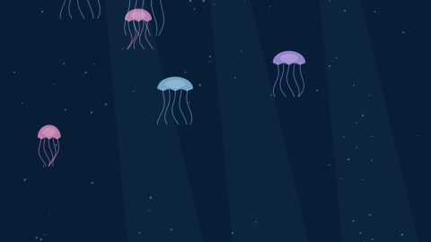 | Jellyfish | water, calm |
| 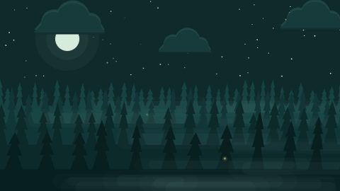 | Firefly forest | night, nature, calm |
|  | Sunset sea | water, calm |
|  | Mountain lake | day, water, calm |
| 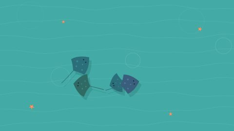 | Stingrays | water, calm |
| 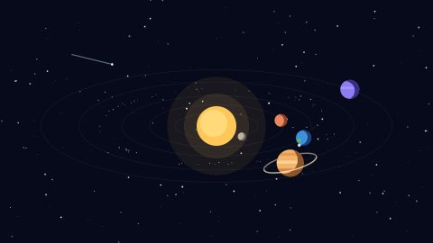 | Solar system | night, space |
| 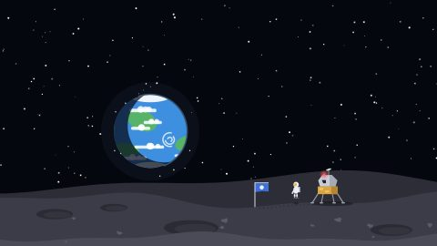 | Earthrise | night, space, calm |
| 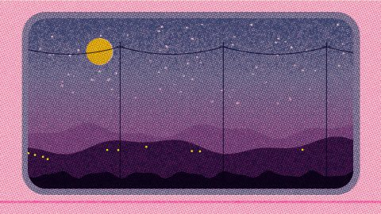 | Night train | night, riso, calm |
| 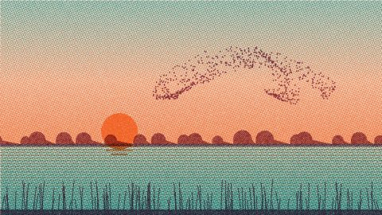 | Starlings | day, riso, nature, calm |
| 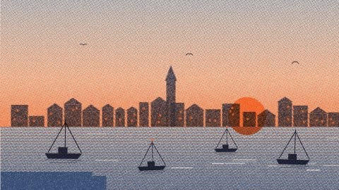 | Harbour | night, water, riso, calm |
| 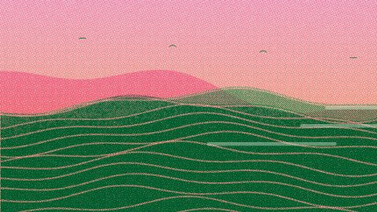 | Terraces | day, riso, nature, calm |
| 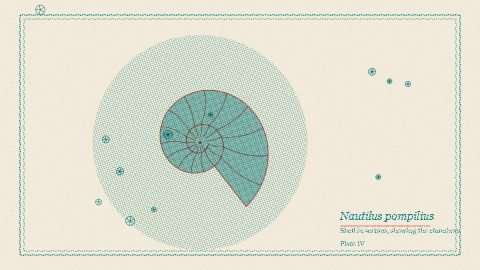 | Nautilus | abstract, riso, calm |
| 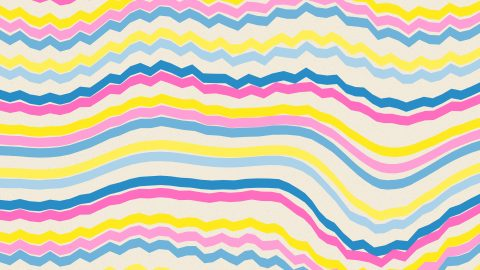 | Marbling | abstract, riso, calm |
| 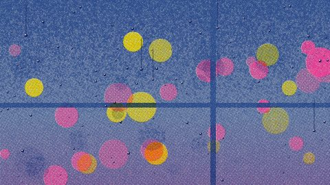 | Rainy window | night, riso, calm |
| 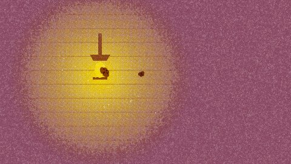 | Moth and lamp | night, riso, calm |
| 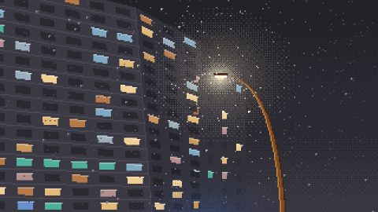 | Snowy lamp | night, pixel, calm |
| 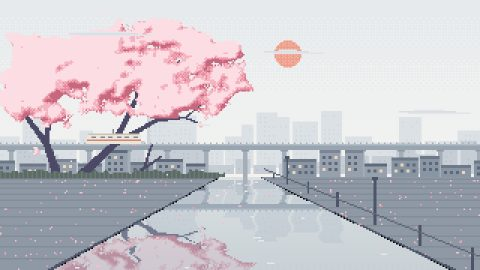 | Blossom canal | day, water, pixel, calm |
| 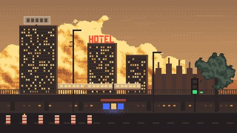 | Golden hour | day, pixel, calm |
| 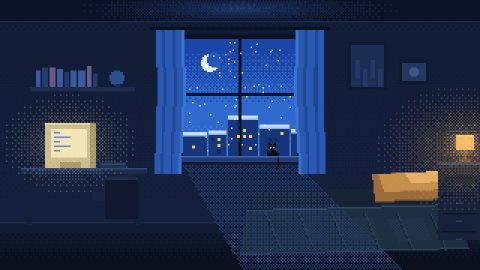 | Night desk | night, pixel, calm |
| 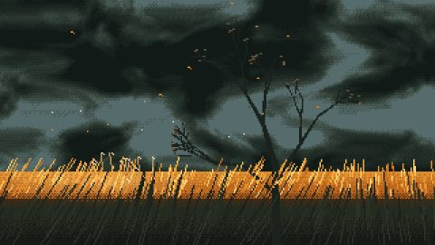 | Ember field | nature, pixel, calm |
| 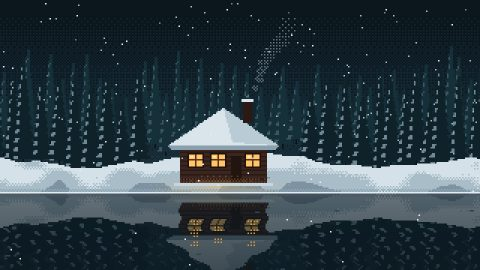 | Snow cabin | night, nature, water, pixel, calm |
| 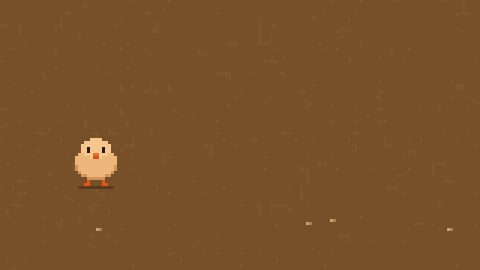 | Little chick | day, pixel, calm |

## How the launcher uses it

```
https://cdn.jsdelivr.net/gh/kjartan-jobloop/tv-screensaver-scenes@v1.1.0/manifest.json
```

`manifest.json` lists every scene with its id, name, tags, thumbnail, file, size and SHA-256 hash. The launcher shows that list in its settings, downloads only the scenes that are ticked, checks each against its hash, caches it and plays it. Always load from a **tagged release** (`@v1.1.0`), so the TVs only run code that was released on purpose. See [docs/LAUNCHER.md](docs/LAUNCHER.md).

## What's here

| Path | What it is |
|---|---|
| `manifest.json` | The scene list the launcher reads (generated, don't edit by hand) |
| `scenes/<id>.js` | One file per scene |
| `thumbs/<id>.jpg` | 480 × 270 thumbnail per scene |
| `player/screensaver.js` | Player: rotation, crossfade, drifting clock, drawing helpers |
| `player/loader.js` | Fetches the manifest and chosen scenes, checks hashes, runs them |
| `index.html`, `play.html` | Preview gallery and full-screen player (GitHub Pages) |
| `tools/build-manifest.js` | Rebuilds `manifest.json`; `--check` is run on GitHub for every push |
| `tools/check.js` | Runs every scene for 60 simulated seconds and fails on errors |
| `tools/thumbnails.html` | Renders the thumbnails |
| `tools/bench.html` | Times each scene against `night` in the same browser |

## Adding scenes

See [docs/ADDING-SCENES.md](docs/ADDING-SCENES.md). In short: add `scenes/<id>.js` and `thumbs/<id>.jpg`, run `node tools/build-manifest.js` and `node tools/check.js`, commit, then tag a release.

## Copyright

Copyright © 2026 kjartan-jobloop. All rights reserved. The files are public so the launcher can fetch them; they are not licensed for reuse.
